<picture>
  <source media="(prefers-color-scheme: dark)" srcset="docs/assets/header-dark.svg">
  
</picture>

<div align="center">

[](https://github.com/raven-clown/logbook/actions/workflows/ci.yml)
[](https://github.com/raven-clown/logbook/releases)
[](https://pkg.go.dev/github.com/raven-clown/logbook)
[](LICENSE)
[](https://scorecard.dev/viewer/?uri=github.com/raven-clown/logbook)

</div>

Shared memory for agents. One agent writes down what it learned, another one finds it later, and everyone can see whether it was checked, corrected or has gone out of date.

logbook is an MCP server (stdio and Streamable HTTP) with the same operations over REST. It is a single Go binary with embedded SQLite, and it runs on Postgres when a team needs more. It works without any model, and gets semantic search and fact extraction when you point it at an OpenAI-compatible endpoint.

> **Status: early, [v0.1.1](https://github.com/raven-clown/logbook/releases/tag/v0.1.1).** Milestones 1 and 2 are released: the memory core with trust states, corrections and staleness, MCP over stdio and Streamable HTTP, REST under `/v1/`, API keys and role bindings, and metrics. The admin API is next. The design is in [docs/design.md](docs/design.md). Watch the repository or pick up an issue if you want to help shape it.

## How it works

<picture>
  <source media="(prefers-color-scheme: dark)" srcset="docs/assets/how-it-works-dark.svg">
  
</picture>

## Why another memory server

Most agent memory today is either a library for one app or a local store for one developer. logbook is built for a team of people and agents that share what they know, and for memory you can trust.

- **Access comes from the token.** Every memory belongs to a user, a project or a team, and logbook reads that from the caller's OIDC token or API key. A caller can't read another team's memories by passing a different id.
- **Memories carry trust.** A memory starts `unverified`. When someone other than its writer confirms it, it becomes `verified`. A team can say its recall returns verified memories only, which also keeps a wrong or planted memory from spreading to every agent.
- **Corrections are kept.** Correcting a memory marks the old one `superseded` and links the two. If an agent later asks the question the old way, it gets the new answer and a note about what changed.
- **Stale facts get noticed.** Each kind of memory has a review period. When it passes, the memory is flagged in results and lands in a review queue.
- **Memories link up.** Typed links (`supersedes`, `contradicts`, `related`, `derived_from`) come back with recall, so an agent sees the context around a fact.
- **No model required.** Full-text search works out of the box. Add an embedder for hybrid search, and an extractor to pull facts out of raw text.

### Compared with mem0 and engram

| | mem0 (open source) | engram | logbook |
|---|---|---|---|
| Runtime | Python library or Docker Compose stack | Go binary, SQLite | Go binary, SQLite or Postgres |
| Needs a model to store anything | Yes | No | No |
| Search | Vector and BM25 | Full-text | Full-text plus vectors, fused |
| Who owns a memory | `user_id` passed by the caller | Project from the working directory | Scope from a verified token, enforced |
| Trust | Every fact weighs the same | Review and judge tools | Trust state that ranking and filtering use |
| Corrections | Old facts accumulate | Updated in place | History kept, recall points to the new fact |
| Team features | SSO, audit logs and on-prem on the paid plan | Self-hosted sync | SSO, roles, audit and replicas, free |

Both are good projects, and engram in particular already thinks hard about stale and conflicting memories. The details and sources are in [section 2 of the design](docs/design.md#2-what-logbook-does-that-mem0-and-engram-dont).

## Everything is free

There is no paid edition and no license key. OIDC sign-in, roles, the audit log, Postgres with several replicas and the full admin API are all in this Apache-2.0 build. Nothing is held back for a hosted version.

## Install

With Go 1.26 or later:

```shell
go install github.com/raven-clown/logbook/cmd/logbook@latest
logbook version
```

Prebuilt binaries for Linux, macOS and Windows and a container image are planned.

## Use it from an MCP client

Add it to any MCP client:

```json
{
  "mcpServers": {
    "logbook": { "command": "logbook", "args": ["mcp"] }
  }
}
```

The agent gets five tools:

| Tool | What it does |
|---|---|
| `remember` | Store a memory, or correct an old one with `corrects` |
| `recall` | Search the memories you can read, ranked by relevance and trust |
| `verify` | Confirm or dispute a memory |
| `forget` | Hide a memory, or purge it |
| `list_memories` | Browse, filter, or walk the review queue |

## Run it as a server

`logbook serve` answers MCP over Streamable HTTP at `/mcp` and the same operations over REST under `/v1/`, on port 8420 by default. Every call needs `Authorization: Bearer <token>`: a logbook API key or an OIDC token from your identity provider.

```shell
logbook key create my-agent                           # prints an lbk_ key once
logbook binding add key:my-agent member team:platform # optional: give it a team scope
logbook serve
```

Point an MCP client at it:

```json
{
  "mcpServers": {
    "logbook": {
      "type": "http",
      "url": "http://localhost:8420/mcp",
      "headers": { "Authorization": "Bearer lbk_...", "X-Project": "mothership" }
    }
  }
}
```

`X-Project` sets the current project, so memories land in `project:mothership` unless the agent asks for another scope. A gateway such as airlock can set it per caller.

The command line talks to a server too:

```shell
export LOGBOOK_TOKEN=lbk_...
logbook recall "which go version does ci use" --server http://localhost:8420
logbook list --order review --server http://localhost:8420
```

To sign people in with OIDC, add the issuer and audience. Teams come from the `groups` claim unless you name another one:

```yaml
public_url: "https://logbook.example.com"
auth:
  bootstrap_admins: ["user:alice@example.com"]
  oidc:
    issuer: "https://idp.example.com"
    audience: "logbook"
  project_mode: "open"   # or restricted: only project members read a project
```

With `public_url` set, logbook serves the OAuth protected resource metadata that MCP clients use to find your identity provider.

`/healthz`, `/readyz` and `/metrics` (Prometheus) are open. Logs are JSON on stdout, every response carries `X-Request-ID`, and `traceparent` is honoured. Set `telemetry.otlp_endpoint` to export traces over OTLP.

A web console and a first-start admin key come with the admin API in the next milestone. Until then, keys and bindings are managed with `logbook key` and `logbook binding` on the server's database.

## Search by meaning and pull facts out of text

logbook works with no model at all. Point it at transponder, or at any OpenAI-compatible endpoint such as OpenAI, Ollama or vLLM, and it also:

- finds memories by meaning, not only by shared words, by fusing full-text and vector results
- links each new memory to up to three near neighbours in its scope with `related` edges
- asks the extractor whether a memory without a `subject` contradicts its closest neighbours, and marks the older one `disputed` when it does
- stores the facts in raw text, such as a conversation turn, when `remember` is called with `extract: true`

```yaml
embedder:
  type: "openai"
  base_url: "http://transponder:8080/v1"
  model: "text-embedding-3-small"
  dimensions: 0          # ask for shorter vectors, when the model supports it
  api_key: ""            # used when there is no caller token to forward
  forward_token: true    # send the caller's OIDC token; only for transponder
extractor:
  type: "openai"
  base_url: "http://transponder:8080/v1"
  model: "memory-extract"
  forward_token: true
```

`forward_token` is off by default, so a caller's token never reaches a service outside your stack. Turn it on only for transponder, which checks the same tokens. logbook API keys are never forwarded.

When the embedder is down, writes are stored without a vector and `degraded: ["embeddings"]` says so. A background loop in `logbook serve` and `logbook mcp` adds the missing vectors once it answers again, and recall falls back to full-text search in the meantime. `/readyz` reports the embedder as `unknown`, `ok` or `failing` from its last call.

Vectors are stored per model. After changing `model` or `dimensions`, run `logbook reindex` to drop the old vectors and embed every memory again. The default vector index keeps a copy of the vectors in the `logbook serve` or `logbook mcp` process, so it serves one process: write through `--server` while a server is running, or restart it after local writes.

## Trust settings

```yaml
trust:
  verify_policy: {project: writers, team: verifiers}   # under verifiers, only a verifier binding's confirms count
  min_status: {user: unverified, project: unverified, team: verified}
  weights: {verified: 1.0, unverified: 0.7, disputed: 0.3, stale: 0.5}
review_periods: {observation: 720h, fact: 4320h, procedure: 4320h, decision: 8760h, preference: 0s}
forget_retention: 720h   # forgotten memories are purged after this
```

With `min_status: {team: verified}`, recall leaves out team memories nobody has confirmed, unless the caller asks for `min_status: unverified`. Give a reviewer the `verifier` role with `logbook binding add user:alice verifier team:platform`.

## Part of a bigger stack

logbook is one of four projects that work alone and fit together, described in the [mothership contract](https://github.com/raven-clown/mothership/blob/main/CONTRACT.md):

- [airlock](https://github.com/raven-clown/airlock), an MCP gateway that can sit in front of logbook for sign-in, permissions and audit
- [transponder](https://github.com/raven-clown/transponder), an LLM gateway that logbook can call for embeddings and fact extraction
- [rosetta](https://github.com/raven-clown/rosetta), a protocol bridge for agents

None of them is required.

## Roadmap

1. **Core** (released in v0.1.0): memory model, trust states, corrections, staleness, SQLite with migrations, MCP over stdio, CLI.
2. **Server** (released in v0.1.0): Streamable HTTP, REST under `/v1/`, OIDC and API keys, role bindings, metrics and traces.
3. **Models** (released in v0.2.0): embeddings, fact extraction and contradiction checks through any OpenAI-compatible endpoint, verify policies and per-scope-type trust settings.
4. **Postgres:** pgvector, several replicas.
5. **Admin API:** settings, API keys, access, audit, usage counts and jobs under `/admin/v1/`, with an OpenAPI file, so a web console can run logbook end to end.
6. **Limits:** the shared `memory.` and `requests` profiles, and the shared metric names.

## Help build it

New contributors are welcome, and there is no closed part of the code.

- Issues labeled `good first issue` are small and say exactly which files to change.
- Issues labeled `adapter` add a backend, an embedder, an importer or a staleness rule. Each one is self-contained, and the plugin interfaces are designed for them.
- Read [CONTRIBUTING.md](CONTRIBUTING.md) for setup, tests and how pull requests are merged.
- Found a bug, or want something new? Open an issue with one of the [issue forms](https://github.com/raven-clown/logbook/issues/new/choose). Each one says what to include.
- Pull requests come with a template that lists what reviewers check first in this project, so you know what to cover before you open one.

Ideas the design already has a slot for: a Qdrant vector index, importers for mem0, engram and Obsidian, and a staleness rule that flags a memory when a file it refers to changes in git.

## A note on the name

This project is not related to [zalando/logbook](https://github.com/zalando/logbook), the Java HTTP logging library, or to the Python logging library of the same name.

## Contributors

Thanks to everyone who has helped build logbook.

<a href="https://github.com/raven-clown/logbook/graphs/contributors"></a>

## License

[Apache-2.0](LICENSE)
